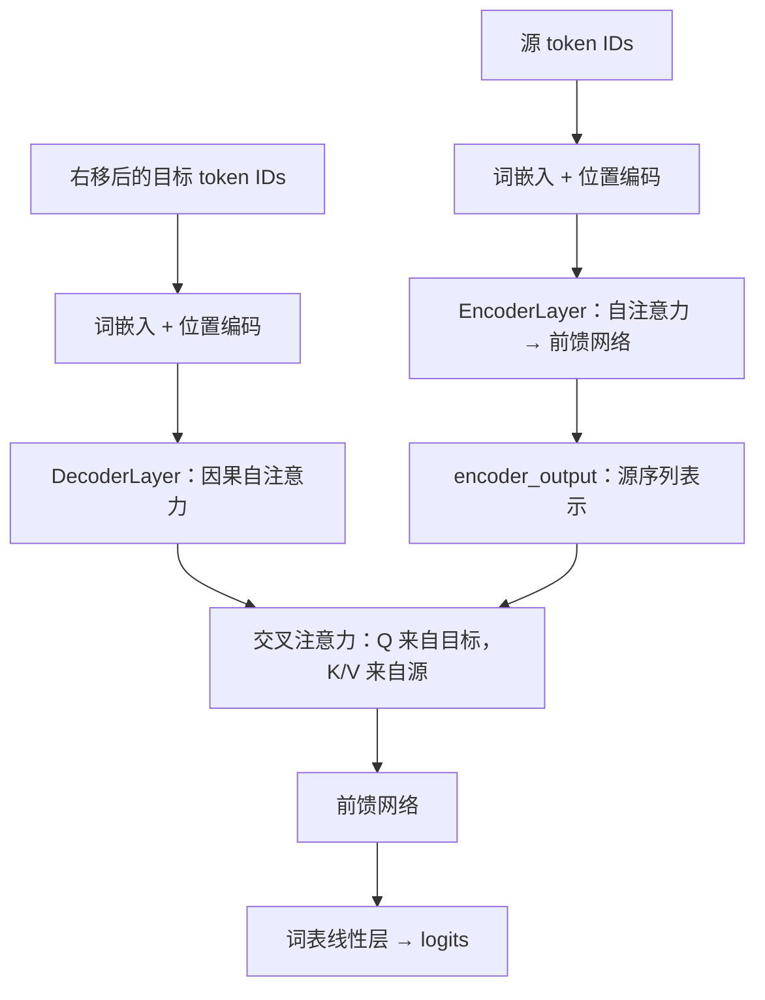

# 从源码角度理解Transformer

理解 Transformer，可以先沿着一个张量往下走：输入是什么形状，经过哪一步计算，哪些位置交换了信息，最后又变成什么形状。

本文以自己的 `Transformer.py` 修正版为线索，依次拆解五个类：`PositionalEncoding`、`MultiHeadAttention`、`PositionWiseFeedForward`、`EncoderLayer` 和 `DecoderLayer`。缩放点积的数值计算也可以结合 [[缩放点积公式代码详解]] 一起阅读。

这份源码实现了编码器和解码器的核心层。词嵌入、多层堆叠、词表输出层与训练循环还需要在外部组装。本文最后给出一个把这些核心层连起来的运行示例。

**按不熟悉的内容选择入口：**

| 想弄清的问题                                              | 阅读位置                                 |                                       |            |
| --------------------------------------------------- | ------------------------------------ | ------------------------------------- | ---------- |
| `self`、`super()`、`forward()`、`dim`、切片是什么意思？         | [[#零、先读懂代码里的 Python 和张量语法\            | 零：基础语法与张量]]                           |            |
| `arange`、`exp`、`sin/cos`、`register_buffer` 怎么用？     | [[#二、PositionalEncoding：告诉模型“我在哪里”\   | 二：位置编码与具体数值]]                         |            |
| `Linear`、`view`、`transpose`、`matmul`、`softmax` 怎么用？ | [[#三、MultiHeadAttention：让不同位置交换信息\    | 三：多头注意力]]                             |            |
| `~mask`、`&`、`masked_fill`、`all`、`keepdim` 是什么？      | [[#四、Mask：限定每个 Query 能看哪些 Key\        | 四：掩码逐步计算]]                            |            |
| 为什么 `transpose` 后还要 `contiguous`？                   | [[#五、combine_heads：把多头结果还原\           | 五：合头与内存布局]]                           |            |
| `ReLU`、`Dropout`、`LayerNorm` 各做什么？                  | [[#六、PositionWiseFeedForward：逐位置加工特征\ | 六：前馈与激活]]、[[#七、EncoderLayer：把两个子层组装起来\ | 七：归一化与残差]] |
| `Embedding`、`reshape`、交叉熵、`backward` 如何连接？          | [[#九、最小运行示例：把源码中的层接起来\                | 九：完整例子与函数拆解]]                         |            |

小例子的浮点输出按便于阅读的精度展示；实际打印有时会出现 `0.10000000149` 等尾数，这是浮点表示的正常现象。新增可独立运行的代码块已经在本机 PyTorch 环境执行核对。

## 零、先读懂代码里的 Python 和张量语法

本文把“函数怎么用”和“为什么用在这里”放在一起解释。遇到一行较长的代码，可以按 **调用对象 → 参数 → 返回值 → 形状变化** 的顺序拆开读。

如果不熟悉 PyTorch，先阅读本节，再看位置编码中的数值例子、多头注意力中的分头例子，以及掩码中的逐步计算。每个以 `import torch` 开头的小例子都可以单独复制运行。

### 1. `import torch.nn as nn`：给模块起一个短名字

```python
import torch
import torch.nn as nn
import math
```

`torch` 提供张量创建、矩阵乘法和自动求导等功能。`torch.nn` 提供线性层、Dropout 等神经网络组件；`as nn` 让我们可以写 `nn.Linear`，完整名字仍然是 `torch.nn.Linear`。`math` 是 Python 的数学模块，这里用到自然对数 `math.log()` 和平方根 `math.sqrt()`。

### 2. `nn.Module`、`__init__`、`self`、`super()` 各做什么？

先看一个比 Transformer 更小的模块：

```python
import torch
import torch.nn as nn

class TinyLayer(nn.Module):
    def __init__(self, width):
        super().__init__()
        self.width = width
        self.linear = nn.Linear(width, width)

    def forward(self, x):
        return self.linear(x)

layer = TinyLayer(4)             # 创建模块，执行 __init__
x = torch.ones(2, 3, 4)
y = layer(x)                    # 调用模块，执行 forward 中的计算
print(tuple(y.shape))           # (2, 3, 4)
```

`class TinyLayer(nn.Module)` 表示这个类继承 PyTorch 的模块基类，因此具有参数管理、设备移动、保存状态等能力。

`__init__` 是初始化方法。创建 `TinyLayer(4)` 时执行它，建立后续反复使用的线性层。**层通常在初始化时创建，输入计算写在 `forward` 中**；若每次 `forward` 都重新创建一个线性层，就会反复生成新的随机参数。

`self` 表示当前这个实例。`self.width = width` 把配置存在实例上，之后其他方法也能读取；`self.linear = nn.Linear(...)` 则把一个子模块挂在当前模块上，PyTorch 会自动登记它的参数。

`super().__init__()` 调用父类初始化，建立模块管理所需的内部状态。源码里的 `super(MultiHeadAttention, self).__init__()` 在这里表达相同目的。

日常使用 `layer(x)` 调用模块，PyTorch 会经由模块调用机制进入 `forward()`，也会处理已注册的钩子。自己通常不需要直接调用 `layer.forward(x)`。参见 [nn.Module 文档](https://docs.pytorch.org/docs/2.10/generated/torch.nn.Module.html)。

### 3. 三维张量究竟是什么？

```python
import torch

x = torch.zeros(2, 3, 4)
print(x.ndim)             # 3：有三个轴
print(x.shape)            # torch.Size([2, 3, 4])
print(x.size())           # torch.Size([2, 3, 4])
print(x.size(0))          # 2：第 0 轴的长度
print(x.size(1))          # 3：第 1 轴的长度
print(x.size(-1))         # 4：最后一轴的长度
```

对本文的 `[B,L,D]`，可以想象为：一批有 2 句话，每句话有 3 个 token，每个 token 用 4 个数字表示。`x[0,1,2]` 是第 0 句话、第 1 个 token 的第 2 个特征值；下标从 0 开始。

注意两个容易混用的意思：`x.ndim == 3` 是“有三个轴”，`x.size(-1) == 4` 是“最后一个轴有四个元素”。

`dim` 参数指定沿哪个轴操作；负数从末尾计数。对于 `[B,H,L,d_k]`：

| 轴下标 | 对应含义 |
| --- | --- |
| `0` 或 `-4` | batch |
| `1` 或 `-3` | 注意力头 |
| `2` 或 `-2` | 序列位置 |
| `3` 或 `-1` | 每头特征 |

因此，`transpose(-2,-1)` 里的 `-1` 是轴下标；而 `view(...,-1)` 里的 `-1` 表示自动推算长度。它们由不同函数解释，含义不同。

### 4. 切片里的 `:`、`0::2`、`None` 怎么读？

```python
import torch

a = torch.arange(6)       # tensor([0, 1, 2, 3, 4, 5])
print(a[:3].tolist())     # [0, 1, 2]：到下标 3 之前
print(a[1:].tolist())     # [1, 2, 3, 4, 5]：从下标 1 开始
print(a[0::2].tolist())   # [0, 2, 4]：每隔 2 个取一个
print(a[1::2].tolist())   # [1, 3, 5]

x = torch.zeros(2, 3, 4)
print(tuple(x[:, :2].shape))     # (2, 2, 4)
print(tuple(x[0].shape))         # (3, 4)：整数下标取出一项，会减少一个轴
print(tuple(x[0:1].shape))       # (1, 3, 4)：切片保留这个轴
```

切片的完整形式是 `开始:结束:步长`，结束位置不包含在结果中。逗号分隔不同轴；后面的轴没有写出时，相当于保留全部内容。

索引中的 `None` 会在当前位置插入一个长度为 1 的轴。例如 `[B,L]` 的 `valid[:,None,None,:]` 会变成 `[B,1,1,L]`，后面的掩码部分会给出实际数据。

### 5. `unsqueeze(dim)`：插入长度为 1 的轴

```python
import torch

v = torch.tensor([0, 1, 2])
print(v.unsqueeze(0).tolist())  # [[0, 1, 2]]，形状 [1, 3]
print(v.unsqueeze(1).tolist())  # [[0], [1], [2]]，形状 [3, 1]
print(tuple(v.shape))          # (3,)：原变量 v 的形状没有改变
```

`dim` 决定新轴插入的位置，原有的三个数字没有增加。对于一维 `v`，`v.unsqueeze(-1)` 也会得到 `[3,1]`。

`unsqueeze()` 返回新视图，通常与原张量共享底层数据；它没有下划线结尾，不会直接把变量 `v` 的形状改掉。源码中的 `position = ...unsqueeze(1)` 是把返回结果重新赋给 `position`。详见 [unsqueeze 文档](https://docs.pytorch.org/docs/2.10/generated/torch.unsqueeze.html)。

### 6. 广播：不同形状为什么还能逐元素相加、相乘？

逐元素运算会**从最右边对齐各轴**。每一对轴的长度必须相等，或者至少有一个为 1；缺失的前导轴视为 1。

```python
import torch

column = torch.tensor([[0.0], [1.0], [2.0]])  # [3, 1]
row = torch.tensor([1.0, 0.1])               # [2]，对齐时看作 [1, 2]
print((column * row).tolist())
# 约 [[0.0, 0.0], [1.0, 0.1], [2.0, 0.2]]，结果 [3, 2]
```

这恰好对应位置编码中的 `position * div_term`：每个位置都乘上每一个频率。

```text
输入向量       [2, 6, 12]
位置编码       [1, 6, 12]
逐轴对齐       2/1 可扩展；6/6 相同；12/12 相同
相加结果       [2, 6, 12]
```

`[2,6,12]` 和 `[6]` 则不能这样相加，因为最右边的 `12` 与 `6` 不匹配。广播主要是计算时按规则复用数据，无需先手动复制多份张量；运算结果仍然需要存储空间。参见 [广播规则](https://docs.pytorch.org/docs/2.10/notes/broadcasting.html)。

### 7. 其他 Python 写法速读

| 源码写法 | 如何理解 |
| --- | --- |
| `d_model: int` | 类型提示，告诉读者这里期待整数，本身不会自动完成运行时校验 |
| `dropout=0.1` | 默认参数，调用时不传就使用 `0.1` |
| `mask=None` | 默认没有提供掩码 |
| `if mask is not None:` | 只在确实传入掩码时执行；不要改成 `if mask:` 来判断多元素张量 |
| `d_model % num_heads` | 求余数，用于检查能否均分 |
| `d_model // num_heads` | 整数除法，例如 `12 // 3 == 4` |
| `raise ValueError(...)` | 输入不符合要求时主动报错，并停止本次调用 |
| `batch_size, seq_len, d_model = x.size()` | 按顺序把三个轴长度分别赋给三个变量 |
| `return x` | 把当前结果返回给调用者 |

## 一、先建立一张源码地图

| 类 | 主要职责 | 输入 → 输出 |
| --- | --- | --- |
| `PositionalEncoding` | 给词向量加入位置信息 | `[B, L, D] → [B, L, D]` |
| `MultiHeadAttention` | 根据 Q、K 的匹配程度融合 V | `[B, Lq, D]`、`[B, Lk, D]`、`[B, Lk, D] → [B, Lq, D]` |
| `PositionWiseFeedForward` | 对每个位置进行非线性特征变换 | `[B, L, D] → [B, L, D]` |
| `EncoderLayer` | 自注意力 + 前馈网络 + 两次残差归一化 | `[B, Ls, D] → [B, Ls, D]` |
| `DecoderLayer` | 因果自注意力 + 交叉注意力 + 前馈网络 | 目标 `[B, Lt, D]`、源表示 `[B, Ls, D] → [B, Lt, D]` |

统一约定：

- `B`：批次大小。
- `L`：序列长度；`Ls`、`Lt` 分别表示源序列、目标序列长度。
- `D = d_model`：每个 token 的特征维度。
- `H = num_heads`：注意力头数。
- `d_k = D // H`：每个头的特征维度；这份实现中每头 V 的维度也等于 `d_k`。
- `d_ff`：前馈网络的中间维度。

后文用 `B=2, Ls=6, Lt=4, D=12, H=3, d_k=4` 举例。所有核心模块默认 batch 在第一维。



图中的嵌入和词表层属于外部组装；源码中的每个注意力、前馈子层都带有残差连接和 LayerNorm。

## 二、PositionalEncoding：告诉模型“我在哪里”

### 1. 为什么输入词向量以后还要加位置编码？

自注意力本身根据向量内容计算匹配程度。如果不加入位置相关信息，模型缺少显式区分词语顺序的线索。

源码使用固定的正弦、余弦位置编码。其形式为：

$$
PE(pos,2i)=\sin\left(\frac{pos}{10000^{2i/D}}\right)
$$

$$
PE(pos,2i+1)=\cos\left(\frac{pos}{10000^{2i/D}}\right)
$$

不同特征维度采用不同频率，为每个位置提供一组有规律的数值。公式来源见原论文的[位置编码部分](https://arxiv.org/html/1706.03762v7#S3.SS5)。

### 2. 对照构造函数读公式

```python
position = torch.arange(max_len).unsqueeze(1)
div_term = torch.exp(
    torch.arange(0, d_model, 2)
    * (-math.log(10000.0) / d_model)
)
pe = torch.zeros(max_len, d_model)
pe[:, 0::2] = torch.sin(position * div_term)
pe[:, 1::2] = torch.cos(position * div_term[:pe[:, 1::2].size(1)])
self.register_buffer("pe", pe.unsqueeze(0))
```

`position` 的形状是 `[max_len, 1]`。`div_term` 为偶数下标维度生成频率系数，广播相乘后，一次算出所有位置、所有频率的相位。

这里的指数写法与公式里的除法等价：

$$
\exp\left(-\frac{2i\log 10000}{D}\right)=\frac{1}{10000^{2i/D}}
$$

`0::2` 对应下标 `0, 2, 4, ...`；`1::2` 对应 `1, 3, 5, ...`。当 `D` 为奇数时，奇数下标的列数会少一列，所以余弦分支需要截取对应数量的频率。

`unsqueeze(0)` 把位置编码变为 `[1, max_len, D]`，方便对一个 batch 中的所有样本共享位置编码。

### 2.1 把位置编码这几行算成具体数字

把 `max_len` 缩小到 3、`d_model` 缩小到 4，就可以直接观察每一步：

```python
import math
import torch

max_len, d_model = 3, 4
position = torch.arange(max_len).unsqueeze(1)
even_dims = torch.arange(0, d_model, 2)
div_term = torch.exp(even_dims * (-math.log(10000.0) / d_model))
angles = position * div_term
pe = torch.zeros(max_len, d_model)
pe[:, 0::2] = torch.sin(angles)
pe[:, 1::2] = torch.cos(angles)

print(position.tolist())       # [[0], [1], [2]]
print(even_dims.tolist())      # [0, 2]
print(div_term.tolist())       # 约 [1.0, 0.01]
print(angles.tolist())         # 约 [[0, 0], [1, 0.01], [2, 0.02]]
print(pe)
# 约为：
# tensor([[0.0000, 1.0000, 0.0000, 1.0000],
#         [0.8415, 0.5403, 0.0100, 0.9999],
#         [0.9093,-0.4161, 0.0200, 0.9998]])
```

逐句对应函数的用法：

| 表达式 | 参数与返回结果 | 在这里的用途 |
| --- | --- | --- |
| `torch.arange(3)` | 从 0 开始，到 3 之前，返回 `[0,1,2]` | 生成位置编号 |
| `torch.arange(0,4,2)` | 从 0 开始、步长 2、到 4 之前，返回 `[0,2]` | 生成偶数特征下标 |
| `math.log(10000.0)` | Python 浮点数的自然对数，约 9.21034 | 构造频率指数中的常数 |
| `torch.exp(t)` | 对张量每个元素求 `e` 的该元素次方，形状不变 | 把负指数转换成频率系数 |
| `torch.zeros(3,4)` | 创建三行四列的零张量 | 准备保存最终位置编码 |
| `torch.sin(t)`、`torch.cos(t)` | 逐元素计算正弦、余弦，输入单位为弧度 | 从相位得到编码值 |
| `pe[:,0::2] = ...` | 修改 pe 的第 0、2 列，所有行都参与 | 写入正弦结果 |
| `pe[:,1::2] = ...` | 修改第 1、3 列 | 写入余弦结果 |

构造函数中的赋值会实际修改 `pe`。与普通 `pe + something` 返回计算结果不同，`pe[...] = ...` 是把数据写入指定切片。

再看最难读的奇数维处理：

```python
pe[:, 1::2] = torch.cos(position * div_term[:pe[:, 1::2].size(1)])
```

把右侧拆开，等价于下面这几步：

```python
odd_columns = pe[:, 1::2]          # 取出需要填写 cos 的那些列
odd_count = odd_columns.size(1)    # 这些列一共有几列
cos_frequencies = div_term[:odd_count]
cos_angles = position * cos_frequencies
pe[:, 1::2] = torch.cos(cos_angles)
```

例如 `d_model=5` 时，正弦负责第 `0,2,4` 列，有三个频率；余弦只负责第 `1,3` 列，只需要前两个频率。截断是为了使赋值左右两侧列数相同。

### 3. buffer 与参数有什么区别？

```python
self.register_buffer("pe", pe.unsqueeze(0))
```

固定位置编码无需由优化器更新，但需要随模型移动设备，并随模型保存。注册成 buffer 正好表达这种状态：`pe` 可以通过 `self.pe` 访问，默认进入 `state_dict()`，但不属于可训练参数。参见 [PyTorch 的 register_buffer 文档](https://docs.pytorch.org/docs/stable/generated/torch.nn.Module.html#torch.nn.Module.register_buffer)。

原代码只写了注册 buffer 的注释，没有实际执行这行语句，因此调用 `forward()` 会出现找不到 `self.pe` 的错误。

### 4. forward 中的广播

```python
x = x + self.pe[:, :x.size(1)].to(dtype=x.dtype)
return self.dropout(x)
```

形状变化是：

```text
输入 x                 [2, 6, 12]
切片后的位置编码       [1, 6, 12]
沿 batch 维广播后相加  [2, 6, 12]
```

序列长度取自 `x.size(1)`。修正版会检查输入维度以及是否超过 `max_len`；超长输入需要增加构造时的 `max_len`。位置编码的 dtype 与输入对齐，设备则通过先把模块和输入移动到同一设备来保持一致。

### 4.1 把位置编码的 forward 完整展开

```python
if x.ndim != 3 or x.size(-1) != self.pe.size(-1):
    raise ValueError("x must have shape [B, L, d_model]")
if x.size(1) > self.pe.size(1):
    raise ValueError("sequence length exceeds max_len")

seq_len = x.size(1)                       # 本次输入有多少个 token
position_part = self.pe[:, :seq_len]      # 取前 seq_len 个位置
position_part = position_part.to(dtype=x.dtype)
x_with_position = x + position_part      # 沿 batch 维广播相加
output = self.dropout(x_with_position)   # 由训练/评估模式决定是否丢弃元素
return output
```

这里展示的是方法内部代码，`self` 和 `x` 来自模块调用。第一条检查使用 Python 的 `or`：只要左侧“不是三维”已经成立，就不会继续计算右侧；这样的短路判断也避免了对错误维数输入继续按预期结构访问。

`x.dtype` 表示元素类型，例如 `torch.float32`；`x.device` 表示数据位于 CPU 还是某块 GPU。`tensor.to(dtype=...)` 转换元素类型，`tensor.to(device=...)` 移动设备，也可以同时指定。对 Tensor 调用 `.to()` 应使用返回值；对 Module 调用 `.to()` 会修改模块中参数和 buffer 的设备/类型，并返回模块本身。

`self.dropout = nn.Dropout(...)` 是创建一个可反复调用的组件，`self.dropout(x)` 才是把本次输入送入该组件。前馈网络一节会给出 Dropout 的具体输出规则。

## 三、MultiHeadAttention：让不同位置交换信息

整个模块可以按五个动作阅读：**投影 → 分头 → 注意力 → 合头 → 输出投影**。

### 1. 为什么有四个线性层？

```python
self.W_q = nn.Linear(d_model, d_model)
self.W_k = nn.Linear(d_model, d_model)
self.W_v = nn.Linear(d_model, d_model)
self.W_out = nn.Linear(d_model, d_model)
```

前三层把输入变换到不同的特征空间：Q 表达当前位置想寻找什么，K 提供匹配线索，V 提供实际要融合的内容。`W_out` 对拼接后的各个头进行可学习的特征混合。

在源码中，`forward(Q, K, V)` 的形参是**投影前的输入**。经过 `W_q/W_k/W_v` 后，同名变量才成为实际用于注意力计算的查询、键和值。

以自注意力为例：

```python
attn_output = self.self_attn(x, x, x, mask)
```

三个输入来自同一个 `x`，但投影层参数各不相同，所以 Q、K、V 通常仍然不同。PyTorch 的 `nn.Linear` 默认还带偏置，常见公式 `Q=XW_Q` 在这里应理解为省略了偏置的简写。

### 1.1 `nn.Linear(in_features, out_features)` 到底算了什么？

`nn.Linear(3,2)` 表示：每个输入向量含 3 个特征，输出向量含 2 个特征。默认有可训练的 `weight` 和 `bias`；权重形状为 `[out_features,in_features]`，实际计算是：

$$
y=xW^\top+b
$$

为了避免随机权重掩盖计算过程，下面手动设置权重，只用于演示：

```python
import torch
import torch.nn as nn

linear = nn.Linear(3, 2, bias=False)
with torch.no_grad():
    linear.weight.copy_(torch.tensor([
        [1.0, 0.0, 1.0],
        [0.0, 2.0, 0.0],
    ]))

x = torch.tensor([[1.0, 2.0, 3.0]])
print(linear(x).tolist())            # [[4.0, 4.0]]
# 第一个输出 = 1*1 + 2*0 + 3*1 = 4
# 第二个输出 = 1*0 + 2*2 + 3*0 = 4

batch = torch.ones(2, 5, 3)
print(tuple(linear(batch).shape))    # (2, 5, 2)
```

`with torch.no_grad():` 临时关闭这段操作的梯度记录，便于给参数写入演示值；`copy_()` 把数值复制到已有权重张量中，末尾的下划线表示原地修改。

对 `[2,5,3]`，线性层独立处理每一个三维向量，前两个轴保持不变。源码中的 `nn.Linear(D,D)` 虽然输入、输出维度相同，内部仍然进行可学习的数值变换，并非原样返回。详见 [Linear 文档](https://docs.pytorch.org/docs/2.10/generated/torch.nn.Linear.html)。

### 2. split_heads：拆分的是特征维度

```python
def split_heads(self, x):
    batch_size, seq_len, d_model = x.size()
    return x.view(
        batch_size, seq_len, self.num_heads, self.d_k
    ).transpose(1, 2)
```

逐步看形状：

```text
[B, L, D]       = [2, 6, 12]
view           → [2, 6, 3, 4]
transpose(1,2) → [2, 3, 6, 4]
                 B  H  L  d_k
```

每个头仍然能访问完整序列；它处理的是投影后的一部分特征维度。`D` 必须能被 `H` 整除，否则就无法按这份实现均分。

不同头可以学习不同的关注模式，但代码没有规定“第一个头必须学习语法、第二个头必须学习语义”，这种分工不能预先保证。

### 2.1 `view()` 与 `transpose()` 的区别，用数据看更清楚

`view()` 按兼容的内存布局重新解释形状，元素总数必须一致；`transpose(a,b)` 交换两个轴。它们承担不同的步骤，不能仅因为最终形状一样就互相替换。

```python
import torch

# 1 个样本，2 个 token，每个 token 有 4 个特征；拆为 2 个头。
x = torch.tensor([[
    [0, 1, 2, 3],
    [4, 5, 6, 7],
]])                                      # [1, 2, 4]

grouped = x.view(1, 2, 2, 2)              # [B, L, H, d_k]
heads = grouped.transpose(1, 2)           # [B, H, L, d_k]
print(heads[0, 0].tolist())               # 第 0 头：[[0, 1], [4, 5]]
print(heads[0, 1].tolist())               # 第 1 头：[[2, 3], [6, 7]]

wrong = x.view(1, 2, 2, 2)                # 只 view，没有交换 L 与 H
print(wrong[0, 0].tolist())               # [[0, 1], [2, 3]]，数据归属不同
```

在 `grouped[B,L,H,d_k]` 中，先选择 token，再选择这个 token 的某个头；在 `heads[B,H,L,d_k]` 中，先选头，再访问该头看到的所有 token。

这个例子特意让 `L=H=2`：两种排列的形状完全相同，但 `heads[0,0]` 与 `wrong[0,0]` 数值不同。因此检查形状时，还要核对每个轴代表什么。

`view(1,2,2,2)` 中各长度的乘积为 8，与原来的 `1×2×4` 相等；改成 `view(1,2,3,2)` 就无法容纳同样多的元素。`view(1,2,-1)` 可让 PyTorch 根据总数推算最后一轴为 4，但只能有一个待推算的 `-1`。参见 [view 文档](https://docs.pytorch.org/docs/2.10/generated/torch.Tensor.view.html) 与 [transpose 文档](https://docs.pytorch.org/docs/2.10/generated/torch.transpose.html)。

### 3. 缩放点积：从匹配分数到信息汇总

```python
attn_scores = torch.matmul(
    Q, K.transpose(-2, -1)
) / math.sqrt(self.d_k)
attn_probs = torch.softmax(attn_scores, dim=-1)
output = torch.matmul(attn_probs, V)
```

暂时忽略掩码，公式是：

$$
\operatorname{Attention}(Q,K,V)
=\operatorname{softmax}\left(\frac{QK^\top}{\sqrt{d_k}}\right)V
$$

对交叉注意力，假设目标长度为 4、源长度为 6：

| 步骤 | 张量形状 | 意义 |
| --- | --- | --- |
| Q | `[2, 3, 4, 4]` | 每个目标位置、每个头的查询 |
| K | `[2, 3, 6, 4]` | 每个源位置、每个头的键 |
| K 转置 | `[2, 3, 4, 6]` | 交换最后两维以便矩阵乘法 |
| QKᵀ | `[2, 3, 4, 6]` | 每个目标位置与全部源位置的匹配分数 |
| Softmax | `[2, 3, 4, 6]` | 在最后的 6 个源位置之间分配权重 |
| 权重乘 V | `[2, 3, 4, 4]` | 汇总每个头的信息 |

`transpose(-2, -1)` 只交换最后两个维度，batch 和头维保持原样。`dim=-1` 则保证每个 Query 分别在自己的所有 Key 之间归一化。

为什么除以 `sqrt(d_k)`？在各分量独立、均值为 0、方差为 1 的简化假设下，点积的方差会随 `d_k` 增大，除以其平方根有助于控制得分尺度，避免 Softmax 过早趋于极端。注意力公式和缩放动机见[原论文的注意力部分](https://arxiv.org/html/1706.03762v7#S3.SS2)。

原代码使用 `torch.bmm()`，但分头后 Q/K 已经是四维张量。`bmm` 要求输入为三维，因此这里改成支持前导批量维度的 `matmul`。也可以先把 `B` 和 `H` 合并再使用 `bmm`，但那需要额外的形状转换。参见 [bmm 文档](https://docs.pytorch.org/docs/2.9/generated/torch.bmm.html) 和 [matmul 文档](https://docs.pytorch.org/docs/stable/generated/torch.matmul)。

### 3.1 `torch.matmul()` 与 `*` 分别在乘什么？

先看二维情况：矩阵乘法把左矩阵的一行与右矩阵的一列对应相乘，再求和。`[m,n] @ [n,p]` 得到 `[m,p]`。

```python
import torch

a = torch.tensor([[1.0, 2.0], [3.0, 4.0]])
b = torch.tensor([[10.0, 20.0], [30.0, 40.0]])
print((a * b).tolist())          # 逐元素相乘：[[10, 40], [90, 160]]
print(torch.matmul(a, b).tolist())
# 矩阵乘法：[[70, 100], [150, 220]]
# 左上角 70 = 1*10 + 2*30
```

`a @ b` 是矩阵乘法的另一种写法；它与上例的 `torch.matmul(a,b)` 表达相同运算。

对四维的 `[B,H,Lq,d_k] @ [B,H,d_k,Lk]`，`matmul` 把最后两轴视为矩阵，前面的 `[B,H]` 视为批量索引。它分别计算每个样本、每个头的乘积；这里不会把不同头彼此相乘。

`Q * K` 只做按位置相乘，无法生成“每个 Query 对所有 Key”的完整匹配表。

### 3.2 `torch.softmax(scores, dim=-1)`：为什么 dim 很重要？

```python
import torch

scores = torch.tensor([[1.0, 2.0, 3.0],
                       [1.0, 2.0, 3.0]])
by_row = torch.softmax(scores, dim=-1)
by_column = torch.softmax(scores, dim=0)
print(by_row)
# tensor([[0.0900, 0.2447, 0.6652],
#         [0.0900, 0.2447, 0.6652]])
print(by_row.sum(dim=-1).tolist())       # [1.0, 1.0]，浮点误差下近似成立
print(by_column)
# tensor([[0.5000, 0.5000, 0.5000],
#         [0.5000, 0.5000, 0.5000]])
```

`dim=-1` 沿每一行的三个得分归一化；`dim=0` 沿每一列的两个得分归一化。虽然输入完全相同，选择不同轴会得到不同权重。

对注意力得分 `[B,H,Lq,Lk]`，最后一轴是 Key 位置，所以要对它做 Softmax。每个 Query 得到自己的 `Lk` 个权重，随后这些权重与 V 相乘，完成加权求和。

### 4. 把多头注意力的 forward 拆成没有嵌套的写法

原代码的 `self.split_heads(self.W_q(Q))` 从内向外执行。展开后是：

```python
q_projected = self.W_q(Q)                    # [B,Lq,D]
k_projected = self.W_k(K)                    # [B,Lk,D]
v_projected = self.W_v(V)                    # [B,Lk,D]

q_heads = self.split_heads(q_projected)      # [B,H,Lq,d_k]
k_heads = self.split_heads(k_projected)      # [B,H,Lk,d_k]
v_heads = self.split_heads(v_projected)      # [B,H,Lk,d_k]

head_output = self.scaled_dot_product_attention(
    q_heads, k_heads, v_heads, mask
)                                           # [B,H,Lq,d_k]
merged = self.combine_heads(head_output)     # [B,Lq,D]
output = self.W_out(merged)                  # [B,Lq,D]
return output
```

这是 `forward` 方法内部的等价展开，不需要重复执行两套代码。`split_heads`、`combine_heads` 是自己定义的普通实例方法；`self.W_q(...)`、`self.W_out(...)` 调用的是注册在实例上的神经网络子模块。

## 四、Mask：限定每个 Query 能看哪些 Key

### 1. 先统一这份代码的约定

本实现使用**允许关注的掩码**：`True/1` 表示可以关注，`False/0` 表示屏蔽。

这份实现不接收 `0/-inf` 形式的加性偏置掩码。不同 PyTorch 接口的布尔掩码语义也可能不同，迁移调用时应先核对对应文档。

为了适配 `[B, H, Lq, Lk]` 的注意力分数，修正版支持：

| 传入形状 | 处理方式 / 用途 |
| --- | --- |
| `[Lq, Lk]` | 扩成 `[1, 1, Lq, Lk]`，所有样本、所有头共用 |
| `[B, Lq, Lk]` | 扩成 `[B, 1, Lq, Lk]`，每个样本单独指定 |
| `[B, 1, 1, Lk]` | 所有 Query、所有头共用该样本的 Key 有效性 |
| 其他四维形状 | 需能广播到 `[B, H, Lq, Lk]` |

二维张量固定解释为 `[Lq, Lk]`。如果手头是 `[B, Lk]` 的 padding 标记，应先写成 `valid[:, None, None, :]`，再传给模块。

### 2. Padding Mask：屏蔽补齐位置

```python
src_mask = (src_ids != pad_id)[:, None, None, :]
```

假设一个样本的源输入是：

```text
token:    A  B  C  PAD  PAD  PAD
有效性:   1  1  1   0    0    0
```

屏蔽的是注意力矩阵的 **Key 列**，使各个 Query 不从 PAD 位置获取信息。这个 mask 可以同时用于编码器自注意力和解码器交叉注意力。

这并不保证 PAD 对应的 Query 行输出为零。后续前馈网络、残差和带偏置的投影仍可能产生数值；训练时还需要在损失中忽略 PAD 标签。

### 3. Causal Mask：屏蔽未来位置

```python
causal_mask = torch.ones(Lt, Lt, dtype=torch.bool).tril()
```

当 `Lt=4` 时：

```text
           Key 位置
            0 1 2 3
Query 0     1 0 0 0
Query 1     1 1 0 0
Query 2     1 1 1 0
Query 3     1 1 1 1
```

第 `i` 个位置只能读取自己和更早位置。训练时，目标输入已经右移：例如用 `[BOS, 我, 爱]` 预测 `[我, 爱, 你]`，所以允许看到当前位置的输入仍然不会暴露当前位置要预测的标签。

目标序列包含 PAD 时，可以把两种限制合并：

```python
tgt_mask = (
    (tgt_input != pad_id)[:, None, None, :]
    & causal_mask[None, None, :, :]
)
```

`DecoderLayer` 接收外部传入的 `tgt_mask`，不会自行生成因果掩码。若传入 `None`，它就会执行不受因果约束的自注意力；用于自回归训练时必须显式传入。

### 4. 为什么还要处理“整行都被屏蔽”？

一般屏蔽逻辑是把相应得分设成负无穷，使其 Softmax 权重为零：

```python
attn_scores = attn_scores.masked_fill(~mask, float("-inf"))
```

但一行全部变成 `-inf` 时，普通 Softmax 会产生 NaN；若全部替换成相同的有限负数，又会得到均匀权重，让本应被忽略的 Value 混入输出。

修正版显式定义这个边界行为：

```python
all_masked = (~mask).all(dim=-1, keepdim=True)
attn_scores = attn_scores.masked_fill(all_masked, 0.0)
attn_probs = torch.softmax(attn_scores, dim=-1)
attn_probs = attn_probs.masked_fill(~mask, 0.0)
```

先让空行的 Softmax 输入有限，再把被屏蔽位置的权重清零。这样该行的加权汇总为零，反向传播也避免了这类 NaN。普通有效行的权重和为 1；整行屏蔽时则为 0。

这里保证的是 `scaled_dot_product_attention()` 的汇总结果为零。完整 `MultiHeadAttention` 后面还有带偏置的 `W_out`，因此最终输出不一定为零。

使用 `-inf` 还避免了原代码中 `-1e9` 无法以 FP16 有限数表示的问题，但它不能消除所有低精度数值风险，例如 QK 点积自身的溢出。

### 5. `~`、`&`、`masked_fill()`、`all()` 分别怎么用？

先用两行得分演示：第一行允许关注两个位置，第二行全部屏蔽。

```python
import torch

scores = torch.tensor([[2.0, 1.0, 0.0],
                       [3.0, 2.0, 1.0]])
mask = torch.tensor([[True, False, True],
                     [False, False, False]])

blocked = ~mask
print(blocked.tolist())
# [[False, True, False], [True, True, True]]

masked_scores = scores.masked_fill(blocked, float("-inf"))
print(masked_scores.tolist())
# [[2.0, -inf, 0.0], [-inf, -inf, -inf]]

all_masked = blocked.all(dim=-1, keepdim=True)
print(all_masked.tolist())                # [[False], [True]]
print(tuple(all_masked.shape))            # (2, 1)

safe_scores = masked_scores.masked_fill(all_masked, 0.0)
print(safe_scores.tolist())
# [[2.0, -inf, 0.0], [0.0, 0.0, 0.0]]

probs = torch.softmax(safe_scores, dim=-1)
probs = probs.masked_fill(blocked, 0.0)
print(probs)
# tensor([[0.8808, 0.0000, 0.1192],
#         [0.0000, 0.0000, 0.0000]])
```

**`~mask`：逐元素逻辑取反。** 对 bool 张量，`True` 变 `False`，`False` 变 `True`。源码先把 mask 转成 `torch.bool` 再取反；若对整数张量直接用 `~`，执行的是整数按位取反，不能按布尔示例理解。

**`tensor.masked_fill(condition,value)`：把 condition 为 True 的位置填成 value。** 因为原 mask 的 True 表示允许关注，需要传入 `~mask` 才能定位要屏蔽的位置。它返回新结果，所以源码把结果重新赋给 `attn_scores`。带下划线的 `masked_fill_()` 才表示原地修改。

`float("-inf")` 是 Python 中表示负无穷的浮点值。Softmax 的指数步骤中，负无穷对应的指数值为零。

**`.all(dim=-1)`：检查最后一轴是否全部为 True。** 上例中第一行有允许的位置，返回 False；第二行全部被屏蔽，返回 True。`keepdim=True` 把被汇总的轴保留为长度 1，结果是 `[2,1]`，能广播回 `[2,3]`，从而整行填零。四维时同理：`[B,H,Lq,Lk] → [B,H,Lq,1]`。

**`a & b`：布尔张量的逐元素“并且”。** 目标 padding mask 和因果 mask 都允许的位置才保留。Python 的 `and` 用于整体真假判断，不适合拿来替代多元素张量的 `&`。例如：

```python
import torch

a = torch.tensor([True, True, False])
b = torch.tensor([True, False, True])
print((a & b).tolist())                  # [True, False, False]
```

相关规则可核对 [masked_fill](https://docs.pytorch.org/docs/2.10/generated/torch.Tensor.masked_fill.html) 和 [all 的 dim/keepdim 参数](https://docs.pytorch.org/docs/2.10/generated/torch.all.html)。

### 6. 用真实形状理解 `[:, None, None, :]`

```python
import torch

ids = torch.tensor([[4, 5, 0],
                    [6, 0, 0]])                 # [B,Lk] = [2,3]
valid = ids != 0
print(valid.tolist())
# [[True, True, False], [True, False, False]]

mask = valid[:, None, None, :]                   # [B,1,1,Lk]
same_mask = valid.unsqueeze(1).unsqueeze(1)
print(tuple(mask.shape))                        # (2,1,1,3)
print(torch.equal(mask, same_mask))              # True
```

这里的 `!=` 对每个 token ID 分别比较，返回同样形状的布尔张量。新加的两个长度为 1 的轴，对应“共享给所有注意力头”和“共享给所有 Query”。`torch.equal(a,b)` 检查两个张量的形状和元素值是否完全一致。

源码中的 `mask.to(device=attn_scores.device,dtype=torch.bool)` 一次完成两件事：把掩码移到得分所在设备，并统一成布尔类型。转换后任何非零数都会变为 True；因此应传入约定的 0/1 或 bool 掩码，不能把 `-inf` 当作屏蔽标记传入这个接口。

## 五、combine_heads：把多头结果还原

```python
def combine_heads(self, x):
    batch_size, num_heads, seq_len, d_k = x.size()
    return x.transpose(1, 2).contiguous().view(
        batch_size, seq_len, self.d_model
    )
```

以长度为 4 的目标序列为例：

```text
注意力输出         [2, 3, 4, 4] = [B, H, L, d_k]
transpose(1,2)  → [2, 4, 3, 4] = [B, L, H, d_k]
contiguous()    → 保持形状，整理内存布局
view            → [2, 4, 12]   = [B, L, D]
```

先把头维移到序列维后面，再拼接各个头的特征。转置后张量通常不再连续，`contiguous()` 让后续 `view()` 能按预期重排。

原代码用三个变量解包四维形状，会在此处报错。修正后，再执行：

```python
output = self.W_out(self.combine_heads(attn_output))
```

多头注意力最终保持 Query 的序列长度，并回到 `d_model` 维，为残差相加做好准备。

### 1. 为什么转置后还要 `.contiguous()`？

张量的“逻辑形状”和底层数据如何存放是两件事。转置通常共享原来的数据，只改变访问这些数据的步长；此时按行读取的逻辑顺序可能不再对应连续内存。

```python
import torch

x = torch.arange(6).view(2, 3)
print(x.tolist())                         # [[0,1,2], [3,4,5]]
t = x.transpose(0, 1)
print(t.tolist())                         # [[0,3], [1,4], [2,5]]
print(t.is_contiguous())                  # False

c = t.contiguous()
print(c.is_contiguous())                  # True
print(c.view(-1).tolist())                 # [0,3,1,4,2,5]
```

直接对本例的 `t` 调用 `view(-1)` 会报错，因为当前步长无法按要求解释为一维；`contiguous()` 按转置后的逻辑顺序整理出连续布局，再 `view(-1)` 就能展开。

它不是把矩阵“转回去”：`c` 的形状仍然是 `[3,2]`，元素位置仍然与 `t` 相同。若输入本来就连续，`contiguous()` 可以直接返回它。参见 [contiguous 文档](https://docs.pytorch.org/docs/2.10/generated/torch.Tensor.contiguous.html)。

`reshape()` 也是改变形状：能复用视图时复用，需要时会复制，因此 `t.reshape(-1)` 也能得到上述一维结果。不过，合头前的 `transpose` 仍然需要保留，因为它决定各个头的特征如何归属到对应 token。

### 2. 把合头的数字接回前面的分头例子

```python
import torch

x = torch.tensor([[[0,1,2,3], [4,5,6,7]]])
heads = x.view(1, 2, 2, 2).transpose(1, 2)
merged = heads.transpose(1, 2).contiguous().view(1, 2, 4)
print(merged.tolist())                    # [[[0,1,2,3], [4,5,6,7]]]
print(torch.equal(merged, x))              # True
```

这个往返示例说明的是形状操作能还原数据顺序。实际注意力会在分头之后更新数值，所以真实模型合头后的内容已经融合了上下文。

## 六、PositionWiseFeedForward：逐位置加工特征

```python
x = self.linear1(x)
x = self.relu(x)
x = self.dropout(x)
x = self.linear2(x)
```

当 `d_ff=24` 时：

```text
[2, 6, 12] → Linear → [2, 6, 24]
           → ReLU   → [2, 6, 24]
           → Dropout→ [2, 6, 24]
           → Linear → [2, 6, 12]
```

`nn.Linear` 作用于最后一个维度，所以所有 token 使用同一组线性层，各自处理自己的特征向量。这个模块内部不进行跨位置的信息交换。

可以把两类模块的分工理解为：注意力负责让位置之间交换信息，前馈网络负责对每个位置已经获得的信息做非线性加工。

忽略 Dropout 后，前馈网络可写成：

$$
\operatorname{FFN}(x)=\max(0,xW_1+b_1)W_2+b_2
$$

先扩展再压回原维度，既增加了中间表示能力，又保持子层接口的 `D` 维形状。

### 1. `nn.ReLU()`：把负值变成零

```python
import torch
import torch.nn as nn

relu = nn.ReLU()
x = torch.tensor([-2.0, -0.5, 0.0, 1.0, 3.0])
print(relu(x).tolist())                  # [0.0,0.0,0.0,1.0,3.0]
```

它对每个元素执行 `max(0,x)`，形状保持不变。`self.relu = nn.ReLU()` 是创建激活函数组件，`self.relu(x)` 是执行它。两个线性层之间加入非线性，才能表达单个线性变换无法表达的映射；如果只连续堆叠两层仿射变换，整体仍可合并为一层仿射变换。参见 [ReLU 文档](https://docs.pytorch.org/docs/2.10/generated/torch.nn.ReLU.html)。

### 2. `nn.Dropout(p)`：训练时随机把部分元素置零

`p` 表示每个元素被置零的概率。训练时，保留下来的元素还会乘以 `1/(1-p)`，保持数值的期望；评估时按原值输出。

```python
import torch
import torch.nn as nn

drop = nn.Dropout(p=0.5)
x = torch.ones(10)

drop.train()
y = drop(x)
print(y)                                # 每项为 0 或 2，具体位置随机

drop.eval()
print(drop(x).tolist())                  # 十个 1.0
```

源码的 `dropout=0.1` 对应约 10% 的置零概率；每次实际置零数量会波动，并不保证精确丢掉 10%。Dropout 不会删除 token 或缩短张量，`[B,L,D]` 的形状保持不变。

`model.train()` 与 `model.eval()` 会递归切换已注册子模块的模式；新建模块默认处于训练模式。`eval()` 调整 Dropout 等模块的行为，但**不关闭自动求导**；推理时通常同时使用评估模式和 `torch.no_grad()`。规则见 [Dropout 文档](https://docs.pytorch.org/docs/2.10/generated/torch.nn.Dropout.html)。

### 3. 前馈模块里每一行如何连接？

```python
self.linear1 = nn.Linear(d_model, d_ff)   # 创建 D → d_ff 的可训练映射
self.dropout = nn.Dropout(p=dropout)     # 创建丢弃规则，没有可训练权重
self.linear2 = nn.Linear(d_ff, d_model)   # 创建 d_ff → D 的可训练映射
self.relu = nn.ReLU()                   # 创建非线性规则，没有可训练权重
```

这些语句在 `__init__` 中执行一次，真正的运行顺序由 `forward` 决定。即使 `self.relu` 写在初始化的最后一行，前向计算仍然会按 `linear1 → relu → dropout → linear2` 执行。

`x = self.linear1(x)` 只是让局部变量名 `x` 指向这一步的新结果，不代表用同样的数值覆盖模型参数。参数存在线性层内部，由后续优化器更新。

## 七、EncoderLayer：把两个子层组装起来

### 1. 先在构造函数中连接依赖

```python
self.self_attn = MultiHeadAttention(d_model, num_heads)
self.feed_forward = PositionWiseFeedForward(d_model, d_ff, dropout)
self.norm1 = nn.LayerNorm(d_model)
self.norm2 = nn.LayerNorm(d_model)
```

原代码创建注意力和前馈模块时没有传入必需参数，实例化 `EncoderLayer` 就会抛出 `TypeError`。修正后，编码器层把自己的维度配置传给两个子模块。

### 2. 顺着 forward 读一遍

```python
attn_output = self.self_attn(x, x, x, mask)
x = self.norm1(x + self.dropout(attn_output))

ff_output = self.feed_forward(x)
x = self.norm2(x + self.dropout(ff_output))
return x
```

第一步，自注意力让源序列中的每个位置根据允许访问的其他位置更新信息。

第二步，`x + ...` 保留输入表示，并叠加子层计算出的更新。这就是残差连接，也为梯度提供了直接经过加法节点传播的路径。

第三步，`LayerNorm(d_model)` 对每个 token 的最后一个特征维进行归一化，再应用可学习的缩放和偏移。它不会把整句话或整个 batch 混在一起统计。参见 [LayerNorm 官方说明](https://docs.pytorch.org/docs/2.9/generated/torch.nn.LayerNorm.html)。

之后再经过前馈网络、另一次残差相加与归一化，输出形状仍为 `[B, Ls, D]`。

这份代码采用 **Post-LN**：

$$
x_{next}=\operatorname{LayerNorm}(x+\operatorname{Dropout}(\operatorname{Sublayer}(x)))
$$

归一化位于残差相加之后。阅读其他实现时可能遇到先归一化再进入子层的 Pre-LN，需要按实际调用顺序区分。

### 3. `nn.LayerNorm(d_model)` 的参数和计算

`nn.LayerNorm(4)` 要求输入最后一轴长度为 4，会分别对每个四维特征向量计算均值、方差：

$$
y=\gamma\odot\frac{x-\mu}{\sqrt{\sigma^2+\epsilon}}+\beta
$$

`epsilon` 防止分母为零。默认可训练的 `gamma` 和 `beta` 分别初始化为 1 和 0，模型可以学习归一化后的缩放和偏移。

```python
import torch
import torch.nn as nn

norm = nn.LayerNorm(2)
x = torch.tensor([[[1.0, 3.0],
                   [10.0, 14.0]]])       # [B,L,D] = [1,2,2]
y = norm(x)
print(y)
# 约 tensor([[[-1., 1.], [-1., 1.]]])
```

第一个 token `[1,3]` 的均值是 2、方差是 1，忽略很小的 epsilon 后得到 `[-1,1]`。第二个 token `[10,14]` 自己计算均值 12、方差 4，也得到 `[-1,1]`。方差按元素数 D 作分母，与默认使用 D-1 的某些样本方差写法不同。

两个 token 的统计量分别计算，batch 之间也分别计算。训练后由于 `gamma`、`beta` 可能变化，最终输出不必始终保持零均值、单位方差。

### 4. 把嵌套的残差语句按执行顺序拆开

源码中的这一行包含三次操作：

```python
x = self.norm1(x + self.dropout(attn_output))
```

可以展开为下面的等价代码：

```python
update = self.dropout(attn_output)   # ① 处理注意力给出的更新
residual_sum = x + update            # ② 输入与更新逐元素相加
x = self.norm1(residual_sum)         # ③ 对相加结果做 LayerNorm
```

三者在当前实现中都是 `[B,L,D]`，因此可以逐元素相加。残差相加既没有沿序列求和，也没有把两个向量拼成 `2D` 维；每个位置、每个特征都保留一个相加后的值。

随后 `ff_output = self.feed_forward(x)` 接收到的是**已经过第一次残差和归一化的 x**。它不是重新读取原始词嵌入。

`norm1` 和 `norm2` 是两个独立的 LayerNorm 实例，各自拥有自己的缩放、偏移参数。`self.dropout` 虽然同一个实例被调用多次，每次训练态调用都会执行随机采样，并不因此共享固定的置零位置。

## 八、DecoderLayer：为什么需要两种注意力？

解码器依次经过三个子层，每个子层后面都有残差连接和 LayerNorm。

### 1. 掩码自注意力：读取目标端上下文

```python
attn_output = self.self_attn(x, x, x, tgt_mask)
x = self.norm1(x + self.dropout(attn_output))
```

Q、K、V 的输入都来自目标端当前表示。因果掩码限定当前位置能读取哪些目标输入。

形状是 `[B, Lt, D] → [B, Lt, D]`，中间注意力矩阵为 `[B, H, Lt, Lt]`。

### 2. 交叉注意力：根据目标端需要读取源信息

```python
cross_attn_output = self.cross_attn(
    x, encoder_output, encoder_output, src_mask
)
x = self.norm2(x + self.dropout(cross_attn_output))
```

这里参数来源发生了变化：

| 角色 | 投影前的输入 | 职责 |
| --- | --- | --- |
| Q | 目标端当前表示 `x` | 当前目标位置需要什么信息 |
| K | `encoder_output` | 源位置提供哪些匹配线索 |
| V | `encoder_output` | 源位置提供哪些信息内容 |

K 和 V 输入相同，但经过各自独立的线性层。目标长度和源长度可以不同：注意力矩阵是 `[B, H, Lt, Ls]`，最终输出仍然是 `[B, Lt, D]`。

源码中的 `src_mask` 应当能适配交叉注意力。通常传入 `[B, 1, 1, Ls]` 的源 padding mask，便可同时广播到编码器的 `[B,H,Ls,Ls]` 和解码器的 `[B,H,Lt,Ls]`。

### 3. 前馈网络：加工融合后的目标表示

```python
ff_output = self.feed_forward(x)
x = self.norm3(x + self.dropout(ff_output))
return x
```

至此，每个目标位置已经结合了允许访问的目标上下文与源序列信息，但输出仍是隐藏向量。还需要接上词表线性层，才能获得预测各个 token 的 logits。

### 4. 一个 DecoderLayer 调用怎样对应到形参？

外部调用：

```python
hidden = decoder(tgt_x, memory, src_mask, tgt_mask)
```

方法定义：

```python
def forward(self, x, encoder_output, src_mask=None, tgt_mask=None):
    ...
```

PyTorch 会把当前 decoder 实例作为 `self`，其余位置参数依次对应 `x=tgt_x`、`encoder_output=memory`。`src_mask` 用于交叉注意力，`tgt_mask` 用于目标端自注意力。

初学时可以使用关键字参数让调用更易读：

```python
hidden = decoder(
    x=tgt_x,
    encoder_output=memory,
    src_mask=src_mask,
    tgt_mask=tgt_mask,
)
```

`encoder_output` 在这里提供数据来源，梯度仍然可以通过交叉注意力传回编码器。正常训练无需把它 `detach()`；`detach()` 会切断该张量到前面计算过程的梯度连接。

`self.self_attn` 和 `self.cross_attn` 是两个分别创建的注意力模块，有各自独立的 Q/K/V/输出投影参数。即使都使用 `MultiHeadAttention` 这个类，参数也不会自动共享。

## 九、最小运行示例：把源码中的层接起来

下面示例可以放在 `Transformer.py` 同目录的另一个 Python 文件中运行。它组装一层编码器、一层解码器以及嵌入和输出层，展示训练时一次前向计算与反向传播。

```python
import math
import torch
import torch.nn as nn
from Transformer import PositionalEncoding, EncoderLayer, DecoderLayer

torch.manual_seed(42)
device = torch.device("cpu")
pad_id, vocab_size = 0, 32
d_model, num_heads, d_ff = 12, 3, 24

src_embedding = nn.Embedding(vocab_size, d_model, padding_idx=pad_id).to(device)
tgt_embedding = nn.Embedding(vocab_size, d_model, padding_idx=pad_id).to(device)
position = PositionalEncoding(d_model, dropout=0.0, max_len=32).to(device)
encoder = EncoderLayer(d_model, num_heads, d_ff, dropout=0.0).to(device)
decoder = DecoderLayer(d_model, num_heads, d_ff, dropout=0.0).to(device)
lm_head = nn.Linear(d_model, vocab_size).to(device)

# 0=PAD，1=BOS，2=EOS；其余数字代表词表中的其他 token。
src_ids = torch.tensor([
    [4, 5, 6, 2, 0, 0],
    [7, 8, 9, 10, 2, 0],
], device=device)
tgt_full = torch.tensor([
    [1, 11, 12, 2, 0],
    [1, 13, 14, 15, 2],
], device=device)

# 右移输入和标签：输入前缀，预测下一个 token。
tgt_input = tgt_full[:, :-1]  # [2, 4]
labels = tgt_full[:, 1:]      # [2, 4]

src_mask = (src_ids != pad_id)[:, None, None, :]  # [2, 1, 1, 6]
Lt = tgt_input.size(1)
causal = torch.ones(Lt, Lt, dtype=torch.bool, device=device).tril()
tgt_mask = (
    (tgt_input != pad_id)[:, None, None, :]
    & causal[None, None, :, :]
)  # [2, 1, 4, 4]

src_x = position(src_embedding(src_ids) * math.sqrt(d_model))
tgt_x = position(tgt_embedding(tgt_input) * math.sqrt(d_model))
memory = encoder(src_x, src_mask)                      # [2, 6, 12]
hidden = decoder(tgt_x, memory, src_mask, tgt_mask)     # [2, 4, 12]
logits = lm_head(hidden)                              # [2, 4, 32]

loss = nn.CrossEntropyLoss(ignore_index=pad_id)(
    logits.reshape(-1, vocab_size),
    labels.reshape(-1),
)
loss.backward()

print("memory:", tuple(memory.shape))
print("hidden:", tuple(hidden.shape))
print("logits:", tuple(logits.shape))
print("loss is finite:", bool(torch.isfinite(loss)))
```

这里 `CrossEntropyLoss` 直接接收 logits，损失前不应再手动 Softmax。示例只做一次前后向计算，没有优化器更新，所以不能据此判断模型已经学会翻译或生成。

训练时可以通过右移输入与因果掩码并行计算各个位置；生成时则需要从 BOS 开始，每次根据当前前缀预测下一个 token，把它追加到输入，再继续计算，直到 EOS 或长度上限。

### 1. `nn.Embedding(vocab_size,d_model,padding_idx)`：按 ID 查向量

Embedding 内部是一张 `[vocab_size,d_model]` 的可训练表。输入的每个整数 ID 取出表中的一行，所以 `[B,L]` 的 ID 会得到 `[B,L,D]` 的向量。

```python
import torch
import torch.nn as nn

embedding = nn.Embedding(5, 3, padding_idx=0)
ids = torch.tensor([[1, 2, 0]])          # 整数 ID，形状 [1,3]
vectors = embedding(ids)
print(tuple(embedding.weight.shape))    # (5,3)
print(tuple(vectors.shape))             # (1,3,3)
print(vectors[0, 2].tolist())            # 新建模块的 PAD 行默认 [0,0,0]
```

`padding_idx=0` 指定第 0 行为填充向量：它默认初始化为零，且通过该嵌入查找获得的梯度不会更新这一行。加入位置编码后，PAD 对应位置的向量仍然可以变成非零，因此还需要注意力 mask 和损失中的 PAD 忽略规则。参见 [Embedding 文档](https://docs.pytorch.org/docs/2.10/generated/torch.nn.Embedding.html)。

`src_embedding(src_ids) * math.sqrt(d_model)` 先查词向量再乘一个标量，最后交给 `position(...)` 加位置编码。缩放词嵌入与注意力中除以 `sqrt(d_k)` 发生在不同位置，处理的也不是同一个张量。

### 2. `[:, :-1]` 与 `[:, 1:]`：输入、标签如何对齐？

假设一行目标序列为：

```text
tgt_full       [BOS, A, B, EOS, PAD]
tgt_full[:,:-1] [BOS, A, B, EOS]    输入：去掉最后一项
tgt_full[:,1:]  [A,   B, EOS, PAD]  标签：去掉第一项
```

`:-1` 的结束位置是最后一个元素，因此会排除它；这里的 `-1` 表示最后一个元素的下标，与前面讲过的轴下标、自动推算长度还要按语境区分。

每个输入位置都预测它后面一项：看到 BOS 预测 A，看到 `[BOS,A]` 预测 B。最后位置对应 PAD 标签，会由损失函数忽略。

### 3. `reshape(-1,vocab_size)`：把每个位置当成一个分类样本

原来的 `logits[B,Lt,V]` 为每个样本、每个位置保存 V 个词表得分。交叉熵这里采用 `[N,V]` 的调用方式，因此把前两个轴合并，其中 `N=B×Lt`。

```python
import torch

logits = torch.zeros(2, 4, 32)
labels = torch.tensor([[11, 12, 2, 0], [13, 14, 15, 2]])
print(tuple(logits.reshape(-1, 32).shape))   # (8,32)
print(labels.reshape(-1).tolist())          # [11,12,2,0,13,14,15,2]
```

两个张量按相同的样本、位置顺序展开，保证每行词表分数仍然对应正确的标签。`-1` 让 PyTorch 自动算出这里的 N 为 8。

### 4. `nn.CrossEntropyLoss(...)(...)`：为什么连续出现两对括号？

```python
loss = nn.CrossEntropyLoss(ignore_index=pad_id)(
    logits.reshape(-1, vocab_size),
    labels.reshape(-1),
)
```

第一对括号创建一个损失模块，第二对括号调用它。可以拆开写成：

```python
criterion = nn.CrossEntropyLoss(ignore_index=pad_id)
flat_logits = logits.reshape(-1, vocab_size)
flat_labels = labels.reshape(-1)
loss = criterion(flat_logits, flat_labels)
```

`flat_logits` 是浮点得分，`flat_labels` 是各位置正确 token 的整数 ID。损失越小，通常表示模型给正确标签分配的概率越高。该接口内部完成稳定的对数概率计算，传入前不用自己 Softmax。

`ignore_index=pad_id` 表示标签为 PAD 的位置不计入损失；默认求均值时，也不计入有效位置数量。本示例有正常有效标签；若一个 batch 所有标签都被忽略，平均损失需要另行处理。参见 [CrossEntropyLoss 文档](https://docs.pytorch.org/docs/2.10/generated/torch.nn.CrossEntropyLoss.html)。

### 5. `loss.backward()`：算梯度；参数更新由优化器执行

前向计算会建立计算图；`loss.backward()` 沿图反向应用链式法则，把参数梯度写入各参数的 `.grad`。它本身不执行优化器更新。

下面用一个标量把区别看清楚：

```python
import torch

w = torch.tensor(2.0, requires_grad=True)
loss = (w - 5.0) ** 2
loss.backward()
print(w.item())         # 2.0：backward 后数值仍然为 2
print(w.grad.item())    # -6.0：导数 2*(2-5)

optimizer = torch.optim.SGD([w], lr=0.1)
optimizer.step()
print(w.item())         # 约 2.6，即 2 - 0.1*(-6)
optimizer.zero_grad()   # 清除本轮梯度，避免下轮意外累积
```

`requires_grad=True` 表示需要为这个张量记录梯度，模型的可训练参数通常已经启用了它。`.item()` 从只有一个元素的张量中取出 Python 数值，适合记录标量；多元素张量不能直接调用它得到一个整体数值。

实际训练通常是“清梯度 → 前向 → 损失 → backward → optimizer.step”。前面的完整示例只演示到 backward；若要训练整套模型，优化器必须包含嵌入、编码器、解码器和输出层等所有需要训练的参数。

`torch.manual_seed(42)` 设置随机数种子，便于重复观察示例；它不能单独保证不同设备、版本下所有运算逐位相同。`torch.isfinite(loss)` 检查是否既不是 NaN 也不是正负无穷，单元素结果可转成 Python 的 `bool`。

### 6. `parameters()`、`state_dict()`、`train()`、`eval()` 放在一起理解

| 接口 | 作用 | 常见使用位置 |
| --- | --- | --- |
| `model.parameters()` | 迭代模型及注册子模块的参数 | 交给优化器 |
| `model.state_dict()` | 获取参数与默认持久 buffer 的状态映射 | 保存模型状态；固定位置编码 pe 也在其中 |
| `model.to(device)` | 移动参数和 buffer | 前向计算前，与输入设备保持一致 |
| `model.train()` | 设置训练模式 | 训练阶段启用 Dropout 等行为 |
| `model.eval()` | 设置评估模式 | 验证和生成阶段关闭 Dropout 等行为 |
| `with torch.no_grad():` | 临时关闭梯度记录 | 推理或手动给参数写入演示数值 |

多个子层被赋给 `self.xxx` 后，父模块才能递归管理它们。这也是自定义模型继承 `nn.Module`、先执行 `super().__init__()`、在初始化中创建子层的重要原因。

## 十、这次检查修正了什么？

| 原代码问题 | 影响 | 修正 |
| --- | --- | --- |
| 只写了 buffer 注册注释 | `self.pe` 不存在 | 注册 `[1, max_len, D]` 的位置编码 |
| 奇数 `d_model` 的 cos 赋值列数不匹配 | 初始化位置编码失败 | 截取对应数量的频率系数 |
| 四维 Q/K 使用 `torch.bmm` | 多头注意力运行报错 | 改为 `torch.matmul` |
| 合头函数按三维解包 | 变量解包报错 | 正确读取 `[B,H,L,d_k]` |
| 编码器、解码器创建子模块时缺少参数 | 层无法实例化 | 传入维度、头数和 Dropout 配置 |
| 三维批次掩码没有补头维 | 广播报错或按错误维度广播 | 明确约定并转换 2D/3D/4D 掩码 |
| 使用 `-1e9` 屏蔽 | FP16 表示范围不足 | 使用 `-inf` 并处理全屏蔽行 |
| 整行全屏蔽后没有额外处理 | 可能产生错误汇总或 NaN | 把空行注意力权重显式清零 |

另外增加了头数、维度和位置编码长度的基本检查，便于在输入配置错误时直接定位原因。

### 修正版的实际验证

2026-10-29 使用本机 `study` 环境中的 PyTorch `2.10.0+cu126` 完成了 7 组验证：

- 位置编码的奇偶维度、位置 0 的已知数值、buffer 注册和长度限制。
- 分头与合头互为逆操作。
- 无掩码以及二维、三维、四维掩码下，注意力输出与 PyTorch `scaled_dot_product_attention` 对照一致。
- FP32、FP16、BF16 下，全屏蔽行汇总为零且梯度有限。
- 源、目标长度不同时，编码器和解码器输出形状正确，所有参数均获得有限梯度。
- 改动目标端未来位置不影响较早位置的输出；改动被屏蔽的源 PAD 位置不影响目标端输出。
- GPU 上的位置编码随模型移动，CPU 掩码可适配 GPU 注意力计算。

上节完整示例也已运行，得到 `memory=(2,6,12)`、`hidden=(2,4,12)`、`logits=(2,4,32)`，损失有限且反向传播成功。这些检查验证了核心计算与修复项；模型的学习效果还需要通过实际数据训练和评估确认。

## 十一、核心层之外还需要什么？

若要把这份教学代码扩展为完整的序列到序列模型，还需要：

1. **词表和分词器**：把文本变成 token IDs，并定义 PAD、BOS、EOS。
2. **源端与目标端 Embedding**：把 IDs 变成 `d_model` 维向量，再加入位置编码。
3. **多层编码器、解码器**：可用 `nn.ModuleList` 注册多层，并在 `forward` 中逐层调用。通常每层应有独立参数。
4. **词表输出层**：把 `[B,Lt,D]` 映射为 `[B,Lt,vocab_size]` 的 logits。
5. **训练流程**：右移目标输入、构造掩码、忽略 PAD 标签、更新参数并评估。
6. **生成循环**：切换到评估模式，从已有前缀逐 token 扩展输出。

当前注意力模块没有对注意力权重单独应用 Dropout；位置编码、前馈网络和残差支路有 Dropout。它适合理解计算过程，若希望逐项复现某个参考实现，还需对齐这些配置。

## 十二、读懂源码时应抓住的主线

这份实现的接口围绕 `[B,L,D]` 展开：位置编码保留形状，注意力临时拆出头维进行跨位置的信息汇总，前馈网络在每个位置变换特征，残差和归一化则把各个子层连接起来。

编码器的自注意力从源序列内部获取信息；解码器先读取受因果掩码约束的目标上下文，再通过交叉注意力读取编码器结果。最后再把目标端隐藏向量投影到词表，才得到用于预测下一个 token 的分数。

以后阅读新的 Transformer 实现，可以反复核对四件事：**Q/K/V 分别来自哪里、张量当前是什么形状、mask 中什么值代表允许、残差和归一化发生在什么顺序**。把这四条线跟清楚，大部分核心计算就能与源码逐句对应。
